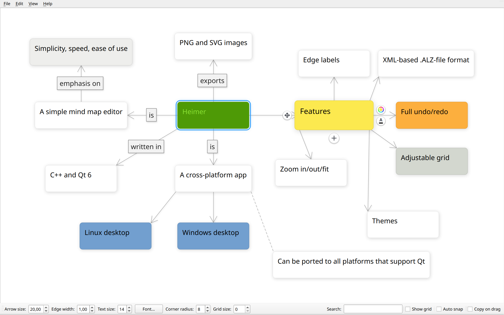
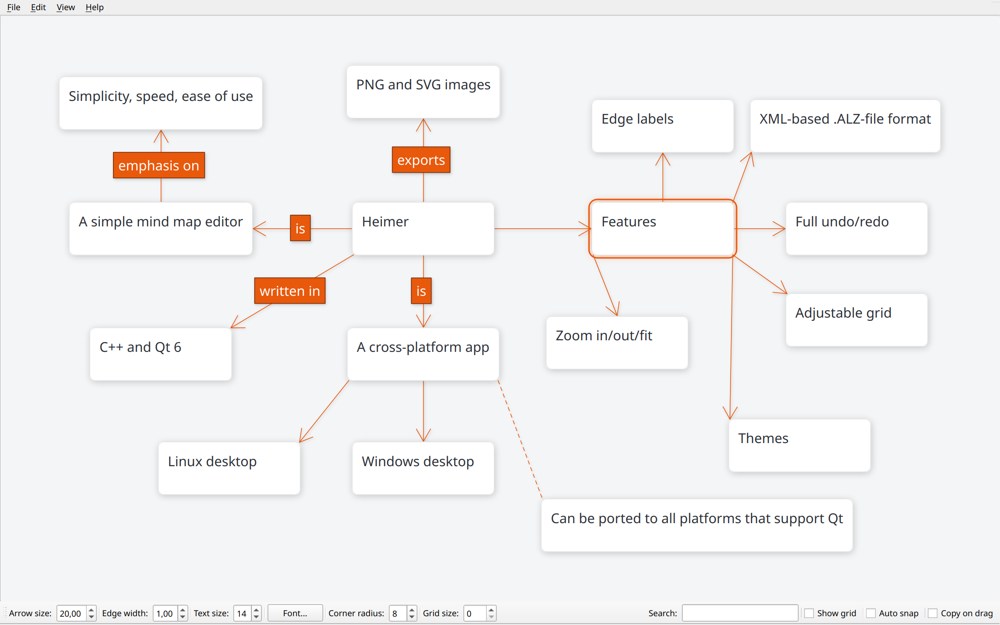
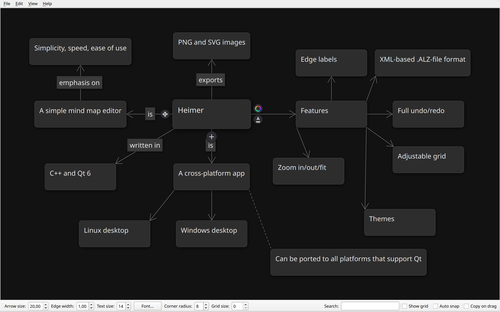
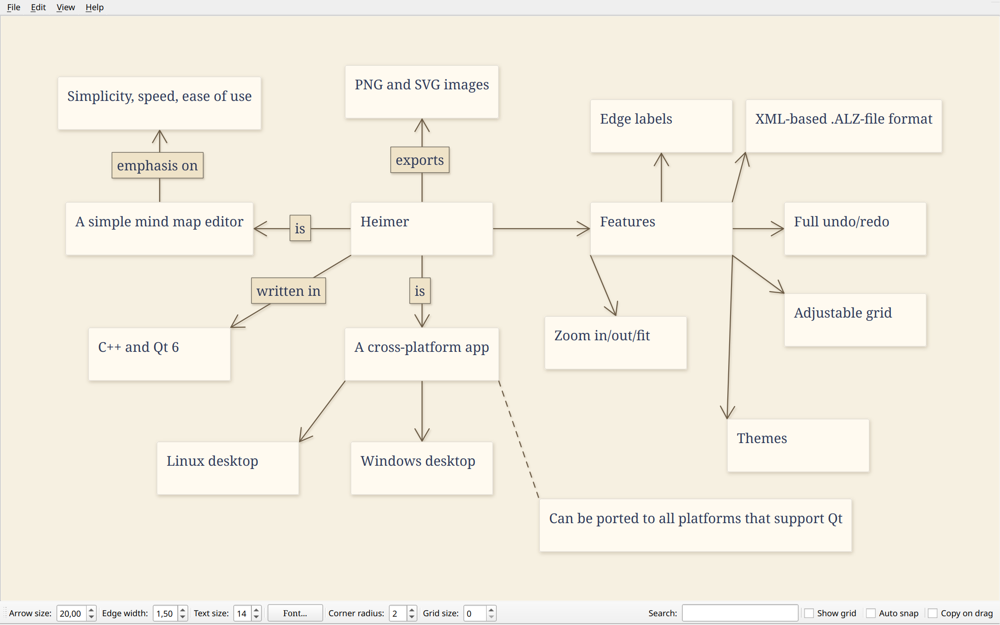
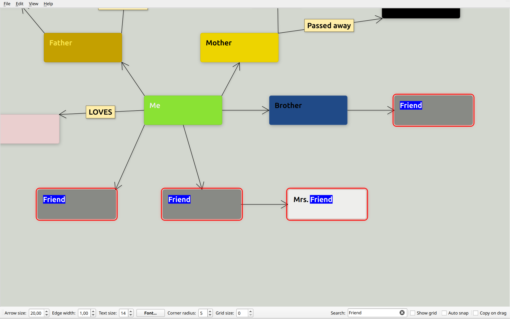
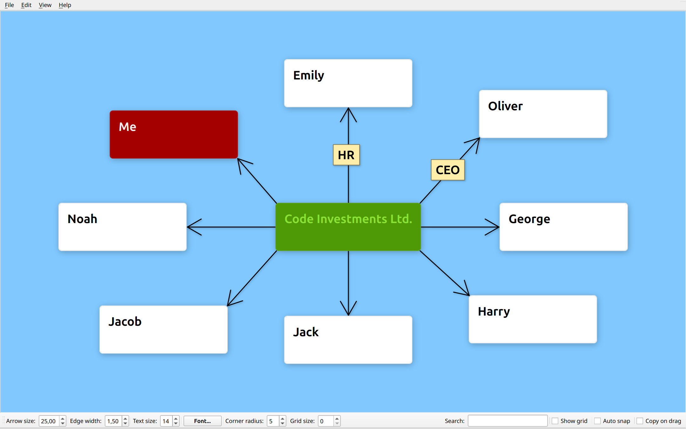
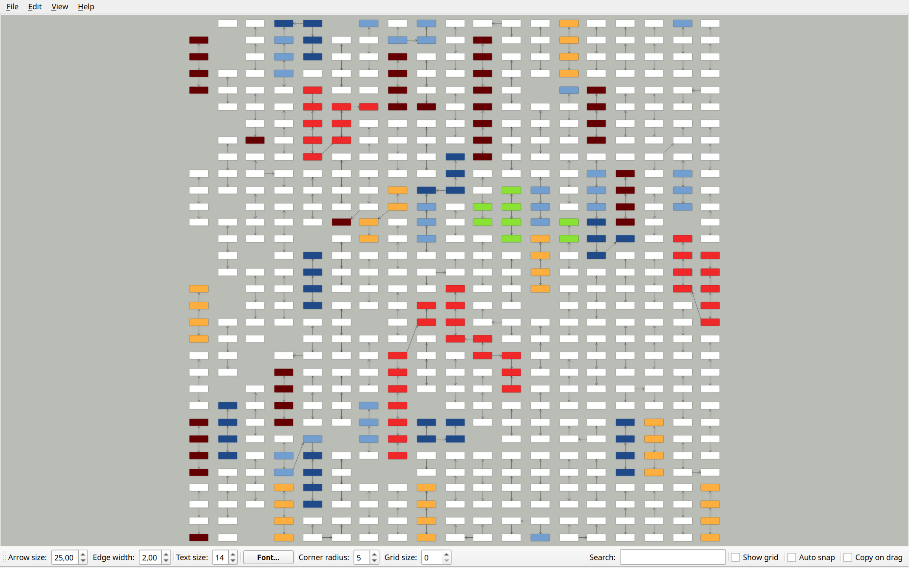

## Heimer

Heimer is a desktop application for creating mind maps and other suitable diagrams. It's written in Qt and targeted for Linux and Windows.

Here are some example mind maps with the built-in themes White, Accent, Black and Paper:

<table>
  <tr>
    <td colspan="3"></td>
  </tr>
  <tr>
    <td></td>
    <td></td>
    <td></td>
  </tr>
  <tr>
    <td></td>
    <td></td>
    <td></td>
  </tr>
 </table>

The project website is at https://juzzlin.github.io/Heimer/

<a href="https://www.youtube.com/watch?feature=player_embedded&v=NXJp6tmmZdE">A very short introduction video to Heimer 1.9.0</a>

## Features

* Adjustable grid
* <a href="https://www.youtube.com/watch?feature=player_embedded&v=acQ8CpaCayk">Automatic layout optimization</a>
* Autoload & Autosave
* Easy-to-use UI
* Export to PNG or SVG
* Forever 100% free
* Full undo/redo
* Nice animations
* Quickly add node text and edge labels
* Save/load in XML-based .ALZ-files
* Themes: built-in and user-defined color, font and shadow presets
* Translations in English (default), Basque, Chinese, Dutch, Finnish, French, German, Italian, Portuguese (Brazil, Portugal), Spanish
* Very fast
* Zoom in/out/fit
* Zoom with mouse wheel

## License

Heimer's source code is licensed under GNU GPLv3.
See COPYING for the complete license text.

All image files, except where otherwise noted, are licensed under
CC BY-SA 3.0: http://creativecommons.org/licenses/by-sa/3.0/

## Installation

See https://github.com/juzzlin/Heimer/releases for available pre-built packages.

### Linux: Snap

On Linux distributions that support universal Snap packages you can install Heimer like this:

    $ snap install heimer

Run:

    $ heimer

For more information see https://snapcraft.io/heimer and https://snapcraft.io/docs/installing-snapd

Snap is the recommended way to install Heimer on Linux.

### Linux: Deb

There are Debian packages for Ubuntu/Debian. Use some graphical tool to install, or as an example on `Ubuntu 22.04`:

    $ sudo apt install ./heimer-4.5.0-ubuntu-22.04_amd64.deb

Run:

    $ heimer

### Linux: AppImage

`AppImage` is a "universal" package that can (in theory) be run on all Linux platforms.

The `AppImage` is built on Ubuntu 22.04 LTS with `Qt 6` included, so it runs on distributions of the same age or newer.

Make the image executable e.g. like this:

    $ chmod 755 Heimer-4.5.0-x86_64.AppImage

Run:

    $ ./Heimer-4.5.0-x86_64.AppImage

### Windows

For Windows there's an installer and alternatively a ZIP-archive that just contains the Heimer executable.

## Setting the language

You can set the language manually with `--lang` option. For example, Finnish:

    $ heimer --lang fi

Show all available options:

    $ heimer -h

## Building the project

The build depends on `Qt 6` (>= `6.2.4`) and `CMake` (>= `3.16`) only.

Use the official `Qt SDK` or install the needed development tools from a package repository.

### Linux / Unix

`Heimer` is being developed on `Ubuntu`, but these instructions should work on any `Debian`-based distro with little or no modifications.

Command to install needed `Qt 6` dev packages on `Ubuntu` (>= `22.04`):

    $ sudo apt install build-essential cmake libqt6svg6-dev libqt6uitools6 linguist-qt6 qt6-base-dev qt6-l10n-tools qt6-tools-dev-tools qt6-tools-private-dev

Building for Linux in a nutshell:

    $ mkdir build && cd build

    $ cmake ..

    $ cmake --build . -j4

Run unit tests:

    $ ctest --output-on-failure

Install locally:

    $ sudo cmake --install .

Debian package (`.deb`) can be created like this:

    $ cpack -G DEB

See `Jenkinsfile` on how to build other packages in Docker.

### Windows

The NSIS installer for Windows is currently built in Docker with MXE (http://mxe.cc):

    $ ./scripts/build-windows-nsis

This is so very cool! A Windowsless Windows build!

Anyway, as the project depends only on `Qt SDK` you can use your favourite `Qt` setup to build the project on `Windows`.

### Docker environment files for CI

Needed `Dockerfiles` can be found at https://github.com/juzzlin/Dockerfiles

